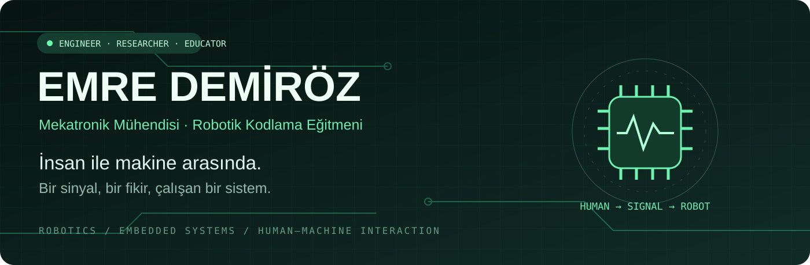
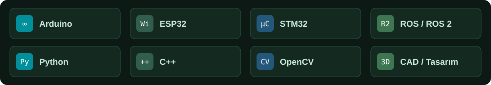

  

  <a href="#-hakkımda">Hakkımda</a> &nbsp; · &nbsp;
  <a href="#-mühendislikten-uygulamaya">Projeler</a> &nbsp; · &nbsp;
  <a href="#-araç-kutum">Teknolojiler</a> &nbsp; · &nbsp;
  <a href="#-mucit-atölyesi">Öğrencilerime</a>

## 👋 Hakkımda

**Merhaba, ben Emre.** Mekatronik mühendisiyim; robotik sistemler, gömülü yazılım ve insan–makine etkileşimi üzerine çalışıyorum. Bir fikrin devreye, kodun harekete ve ölçümün anlamlı bir sonuca dönüşmesini seviyorum.

🎓 **Sakarya Uygulamalı Bilimler Üniversitesi** — Mekatronik Mühendisliği yüksek lisans çalışmalarımda biyolojik sinyaller, sinyal işleme ve yapay zekâ destekli analizle ilgileniyorum.

🤖 **Mucit Akademisi** — Robotik kodlama eğitmeni olarak Arduino, ESP32, IoT ve temel elektronik alanlarında uygulamalı eğitimler veriyor; öğrencilerin proje geliştirme ve problem çözme becerilerini destekliyorum. TÜBİTAK ve TEKNOFEST çalışmalarında mentorluk yapıyorum.

> **Çalışma yaklaşımım:** Önce problemi anla. Küçük bir model kur. Ölç, geliştir ve öğrendiğini paylaş.

## 🧭 İlgi alanlarım

<table>
<tr>
<td width="33%" valign="top">

### 🦾 Robotik
Otonom mobil robotlar, ROS/ROS 2, navigasyon ve simülasyon.

</td>
<td width="33%" valign="top">

### 🧠 İnsan ↔ Makine
EOG tabanlı arayüzler, biyolojik sinyaller ve sinyal sınıflandırma.

</td>
<td width="33%" valign="top">

### 🌱 Eğitim & IoT
Sensörler, akıllı sistemler ve öğrencilerle uygulamalı mühendislik.

</td>
</tr>
</table>

## 🔧 Araç kutum

**Gömülü sistemler:** GPIO · PWM · ADC · UART · I²C · SPI · sensör entegrasyonu · motor kontrolü  
**Yazılım ve araştırma:** Python · C++ · OpenCV · NumPy · sinyal işleme  
**Tasarım ve simülasyon:** Fusion 360 · SolidWorks · URDF · Gazebo · RViz

## 🚀 Mühendislikten uygulamaya

| Proje | Keşif alanı |
| --- | --- |
| [👁️ EOG tabanlı mobil robot](https://github.com/emredemiroz1/EOG-based-mobile-robot) | Biyolojik sinyallerle insan–makine etkileşimi |
| [🚗 ROS 2 Ackermann Drive Car](https://github.com/emredemiroz1/ROS2-Ackermann-Drive-Car) | Mobil robotlar ve Ackermann sürüş |
| [🏁 GTÜ KelebekRO](https://github.com/emredemiroz1/GTU-Kelebekro) | Gel–Tasarla–Üret kategorisinde ekip çalışması ve ikincilik |
| [🧩 ROS / URDF eğitimi](https://github.com/emredemiroz1/Ros_urdf_egitimi) | Robot modellerini tanımlama ve öğrenme |

📄 **Akademik çalışmalarımdan:** [HoReCa Sektörü için Doğal Navigasyon Otonom Mobil Servis Robotu: komiBot](https://dergipark.org.tr/tr/pub/joinssr/issue/80952/1387566)

## 🌈 Mucit Atölyesi

**Hoş geldin küçük mucit!** GitHub, projelerimizi ve kodlarımızı paylaştığımız bir çalışma alanı. Buradaki ders sayfalarını bir dijital kitap gibi okuyabilirsin. Başlamak için bir kapı seç:

<table>
<tr>
<td width="50%" align="center">

### 📖 Ders kitabım
Robotik konularını keşfet, ders notlarını oku ve küçük görevleri dene.

**[Derslere başla →](https://github.com/emredemiroz1/Mucit-Akademisi-Dersler#readme)**

</td>
<td width="50%" align="center">

### 🧩 Bloklarla kodlama
mBlock ile ışıkları, butonları ve elektronik devreleri programla.

**[mBlock kitabını aç →](https://github.com/emredemiroz1/Mucit-Akademisi-mBlock-ile-Arduino#readme)**

</td>
</tr>
</table>

[🚀 2026–2027 öğrenme haritası](https://github.com/emredemiroz1/Mucit-Akademisi-Dersler/tree/main/2026-2027) &nbsp; · &nbsp; [🤖 RoboMer kartını tanıyalım](https://github.com/emredemiroz1/Mucit-Akademisi-Dersler/blob/main/2026-2027/Ders_Notlari/01_RoboMer_Kart_Tanitimi.md)

> 🔍 **Öğrencilerime:** Kodu çalıştırmadan önce sonucunu tahmin et. Bir şeyi değiştir, gözlemle ve nedenini kendi cümlelerinle anlat. Hata mesajları da keşfin bir parçası!

  

